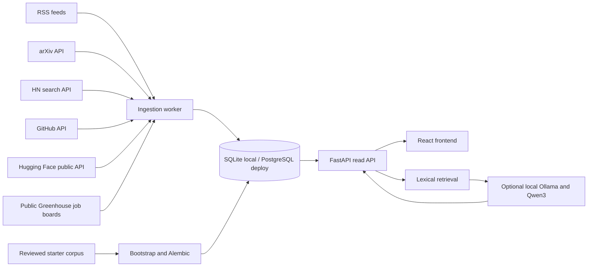
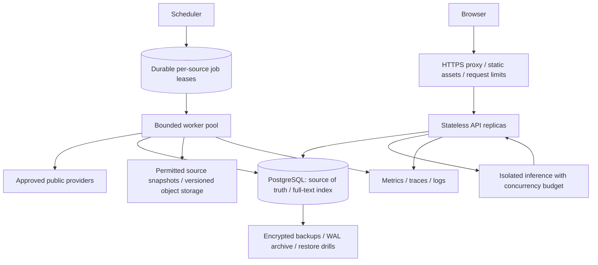

# AItlas architecture and implementation design

## Product boundary

AItlas connects five kinds of evidence: current developments, foundational knowledge, company activity, real implementations, and possible opportunities. The current build is a production-shaped V1, not a claim to cover the whole AI field. It is intentionally narrow in the historical archive and company library.

### Current user journeys

1. **Morning scan:** open the overview, read the indexed coverage summary, switch between business and developer signals, inspect news/papers/repos/models, and open original sources.
2. **Understand context:** open a signal's historical context panel, follow cited papers, and explore the timeline.
3. **Research a deployment:** inspect a company profile and the corresponding use case, including how the outcome was reported.
4. **Explore a possibility:** open an opportunity hypothesis, inspect its adjacent evidence and barriers, then conduct separate validation.
5. **Ask a question:** retrieve relevant indexed records; use extractive answers by default or optional local model synthesis with numbered citations.
6. **Track the market:** search active AI-company job boards by role, employer and location; compare live hiring counts and news mentions with reviewed company evidence.

### What V1 does not claim

No comprehensive company stack discovery, complete global job market coverage, paper lineage graph, verified adoption scores, measured market size, 24-hour GitHub star velocity, personalized email digest, or statistically valid opportunity penetration metric is implemented. Those require additional data rights, identity, review and measurement work. They are not silently simulated in the UI.

## System diagram

The API never fetches arbitrary user-provided URLs. An operator configures the source registry; API adapters are restricted to their expected public hosts. The worker runs outside request processing. Nginx serves static frontend assets and proxies `/api` in the Compose setup.

## Technology choices

| Layer | Choice | Reason |
|---|---|---|
| Web | React 19, TypeScript, Vite, plain CSS, Lucide, self-hosted OFL fonts | Fast local iteration and static deployment; no proprietary runtime dependency |
| API | FastAPI, Pydantic, SQLAlchemy 2 | Typed contracts, API documentation, portable data access |
| Storage | SQLite on a laptop; PostgreSQL 17 in Compose | One-command local setup and a reliable concurrent production database |
| Migration | Alembic | Versioned schema changes; bootstrap applies the initial revision |
| Ingestion | Python worker, HTTPX, feedparser, OS trust store | Independent source failure handling and bounded HTTP calls |
| Optional LLM | Ollama with Apache-2.0 Qwen3-8B | Local inference with a permissively licensed model; no paid API requirement |
| Future hybrid search | PostgreSQL full-text plus pgvector | Prefer simple indexed retrieval until semantic search has demonstrated value |

Everything in the application runtime is open source. Public feeds and publisher APIs are external **data sources** whose content and API terms still apply. The model is optional. The frontend does not contact a font CDN at runtime.

## Data model and provenance

- `sources`: operator-configurable endpoint, adapter, options, enabled flag, poll interval, next due time, failure count, last successful sync, error and count.
- `items`: normalized URL, kind, title, short summary, source, publication/discovery time, tags, score, structured source metadata, active status and last-seen time. Job rows include company, location and role; model rows include source-supplied rank, task and license when present.
- `knowledge`: curated historical milestone, year, topic, paper URL, and related IDs.
- `companies` and `evidence`: a profile plus individual cited claims. A profile without cited evidence should not be labeled as having an AI maturity tier.
- `use_cases`: deployment summary, reported outcome, domain, maturity label and evidence URL.
- `opportunities`: a clearly marked hypothesis, barrier and adjacent evidence URL.
- `job_runs`: ingestion status, errors and insertion count for operational review.

Every displayed current item has a source URL. Case-study outcomes are explicitly publisher-reported. `published_at` is source-provided; `discovered_at` is ingestion time. Time zones are converted to UTC on ingestion and formatted in the viewer's local time.

## Ingestion rules

1. Poll each enabled source when its own schedule is due, fetch a bounded number of entries with a 20-second request timeout, and retry transient errors once. A failed source gets exponential backoff and does not abort the others.
2. Clean markup, limit excerpt length and reject non-HTTP links. Remove common tracking parameters from canonical URLs.
3. Deduplicate by canonical URL and close title match within a three-day window. This avoids obvious syndicated duplicates; entity-level story clustering remains future work.
4. Apply simple relevance tags and a transparent heuristic score. Display recency separately. No hidden claim of editorial review or true trend velocity.
5. Commit each source independently; a repeated run is idempotent for existing canonical links.
6. Track refresh timestamps and show empty states instead of manufacturing content when sources fail.
7. For each successful complete Greenhouse board response, update current roles and mark a missing role inactive after two consecutive absences. Failed board requests never expire jobs.
8. Preserve source-supplied model trending rank. A GitHub repository's star change is compared only with its prior sync; it is not labeled 24-hour velocity.

Source APIs can throttle or change formats. A production operator should provide a GitHub token and monitor error trends. The worker stores each source's next poll time and backs off after failures. PostgreSQL advisory locking prevents two worker replicas from running the same cycle. At larger scale, a durable queue with per-source jobs and dead-letter handling should replace the single polling loop.

## Retrieval and answer safety

Global search paginates through the full active catalog, including jobs, models and reviewed records, using database text filters. Q&A selects up to 500 matching live candidates and ranks them with token overlap alongside reviewed content. This makes behavior inspectable without an embedding model, though SQL `LIKE` filters need full-text indexes as the corpus grows. The answer endpoint returns explicit no-match results. Extractive mode reports the closest indexed snippets. If Ollama is configured, the prompt instructs the local model to use numbered snippets only, and the API accepts a generated answer only if its citation numbers refer to retrieved records. This **does not prove every generated claim is correct**; the UI asks readers to review linked sources.

At larger scale: add PostgreSQL `tsvector`/GIN for keyword retrieval, `pgvector` HNSW for semantic candidates, a cross-encoder reranker, and a claim-to-citation validation pass. Keep source snapshots and retrieval logs so answers can be audited. Do not import full papers or articles without appropriate rights.

## Security and reliability

- Public API is read-only except for `POST /ask`; ingestion and curation have no HTTP admin endpoint.
- Questions have length limits. Nginx applies per-client rate limiting to `/api/ask` in Compose. A larger or model-backed deployment needs shared rate limiting and an inference budget. Do not expose Ollama directly.
- Frontend renders text normally rather than injecting feed HTML. Source links use `noopener noreferrer`.
- Docker web port binds to `127.0.0.1`; Nginx re-resolves the API through Docker DNS after container replacement. Public hosting needs TLS at a reverse proxy, a fixed allowlist of origins, request limits and routine patching.
- Database credentials belong in environment or secret storage. Do not commit `.env` files. Use encrypted daily backups and a restore drill for PostgreSQL.
- Add structured metrics for source success, lag, duplicate rate, API latency and answer no-match rate. Alert on persistent source failure and stale data.
- Migrations run before API and worker start. Deploy migrations once, then roll application instances.

## Scale path

For the first thousands of records, one API, one worker and PostgreSQL are sufficient. Add indices on kind, publication date and source. At tens of thousands of items, move retrieval into database full-text indices and partition or archive old live items. At higher ingestion volume, split source adapters into queue jobs with per-source rate limits and dead-letter handling. Keep curated knowledge and evidence independent from volatile feed items.

## Next phases

1. **Depth:** choose one domain, import permitted primary papers, add entity resolution and reviewed links between concepts, papers, models and people.
2. **Accounts:** add OIDC, organization tenancy, consent, server-side saves/follows, account export/deletion, and per-user feed preferences.
3. **Search:** add hybrid retrieval only after an evaluation set of real questions shows a relevance improvement.
4. **Company and career intelligence:** expand verified public boards and licensed sources, normalize locations, measure coverage, and add evidence freshness and conflict resolution.
5. **Opportunity analysis:** build a workflow taxonomy, sourced denominator estimates and explicit confidence intervals; then validate with domain experts before ranking markets.
6. **Editorial quality:** add review tools, corrections, source takedown handling and automated regression evaluations for grounded answers.

## Revised target design (2026-10-31)

The stack decision and realistic alternatives are in [BACKEND_DECISION.md](BACKEND_DECISION.md). Keep one modular application codebase, deploy the read API and ingestion workers independently, and keep inference off API/ingestion processes. SQLite remains a development convenience; use PostgreSQL for a concurrent deployment.

This is a **target**, not a claim that every component is deployed. Current Compose has one PostgreSQL instance, API processes, a sequential source worker, and Nginx on one host. It is deployable but not highly available. Host/DB failure can interrupt it. There is no defined production SLA or measured capacity yet.

### First production priorities

1. **Durable source jobs.** Replace the whole-cycle advisory lock with one durable task per source: source ID, due time, lease expiry, attempt count, last error, next retry, and unique scheduled execution ID. Claim ready work transactionally with `FOR UPDATE SKIP LOCKED`, commit the lease, fetch outside the transaction, then commit normalized records and completion atomically. Renew long leases, recover expired leases, and make writes idempotent. Delivery is at least once; do not claim exactly-once processing. Quarantine repeated failures and expose an operator retry action. Keep provider-specific token buckets, jitter and Retry-After handling. PostgreSQL is enough initially; introduce Valkey with a durable broker or RabbitMQ only when measured queue needs justify operating another system.
2. **Search and data model.** Move job city, employer, role, AI relevance and publication/activity timestamps into indexed typed fields rather than scanning JSON/LIKE as volume grows. Add `tsvector`/GIN and trigram indexes, keyset pagination and query timeouts. Store article/model/paper/repository identities separately from evidence observations. Add hybrid embeddings only when relevance evaluation shows a benefit; embeddings are not verification. OpenSearch is a later choice for complex faceting/search load after PostgreSQL is measured.
3. **Quality pipeline.** Retain publication time versus discovery time, source type, fetched-at, license/usage constraints, content hash, extractor version, and corrections. Missing/unparseable publication dates currently fall back to fetch time and need an explicit unknown-date flag before strict freshness guarantees. Maintain independent coverage metrics by lab, language, topic, region and ATS. Source health does not prove completeness. Story clusters should retain all provenance, distinguish syndication from independent evidence, and keep contradictory reports visible. Benchmark/obsolescence claims require task and evaluation context. Prices need a licensed provider, exchange/session timestamp, currency and adjusted/unadjusted baseline; news co-occurrence cannot prove a price movement was caused by AI news.
4. **Availability.** Use two API replicas across failure domains, a proxy/load balancer, and a PostgreSQL primary with a tested standby/failover plan. Bound connection pools against DB limits. Use rolling deployments and backward-compatible expand/migrate/contract schema changes. Set RPO/RTO targets explicitly (suggested starting targets: 15-minute RPO and 1-hour RTO), implement WAL archiving and restore rehearsals, and verify them before promising them. Compose on one laptop/VM does not satisfy those targets automatically.
5. **Cache and observability.** Cache read-heavy intelligence pages for 30–60 seconds with source-as-of timestamps and serve stale data with a clear status during provider failures. Add OpenTelemetry, Prometheus and Grafana; use structured logs with secrets/query redaction. Alert on per-source freshness lag, queue age, error rates, exhausted retries, missing ingestion, DB pool saturation, API p95 and model timeouts. Freshness budgets should be tied to each source's cadence and availability, not one global 'live' flag.

### Security boundaries and remaining gates

The current public API exposes reads and question answering, not an admin/source-write interface. Its Nginx proxy sets CSP, frame and content-type protections, request body/time limits, a read API rate limit and a stricter ask limit. Feeds render as text; response sizes are bounded and TLS verification stays enabled. No private enterprise connector is part of the application.

Before internet exposure, add TLS and HSTS at the public edge, trusted proxy configuration, shared rate/LLM concurrency limits across replicas and dependency/container vulnerability scanning. Accounts require OIDC (e.g. self-hosted Keycloak), short-lived sessions in Secure/HttpOnly/SameSite cookies, CSRF protection for account mutations, RBAC for editors, audit logs, retention/deletion and owner checks for every save/follow query. Keep secrets outside Git, rotate them, and use separate least-privilege DB identities for migrations, API and ingestion.

The worker is an outbound trust boundary: the operator-only HTTPS registry and API-host restrictions reduce exposure but do not fully prevent SSRF through malicious DNS or redirects. Enforce network egress rules that deny loopback, private/link-local/metadata ranges; validate DNS and every redirect; cap redirects, decompressed bytes and total elapsed time; restrict credential forwarding by host; and quarantine malformed inputs. Run containers without root/capabilities, with constrained CPU/memory and writable paths. Do not expose database or inference ports publicly.

Treat retrieved text as untrusted data. The local model has no tools, secrets or network authority. Instructions and citation-number checks do not establish factual entailment or prevent all prompt injection. Keep extractive fallback, source-date/coverage disclosures, answer audits, unsupported-question tests, adversarial retrieval tests and human review for material company/market claims. Do not execute fetched code or automatically install discovered repositories.

References: [PostgreSQL locking and queue consumers](https://www.postgresql.org/docs/current/sql-select.html), [OWASP SSRF prevention](https://cheatsheetseries.owasp.org/cheatsheets/Server_Side_Request_Forgery_Prevention_Cheat_Sheet.html), [OWASP prompt injection prevention](https://cheatsheetseries.owasp.org/cheatsheets/LLM_Prompt_Injection_Prevention_Cheat_Sheet.html), [FastAPI deployment concepts](https://fastapi.tiangolo.com/deployment/concepts/).
