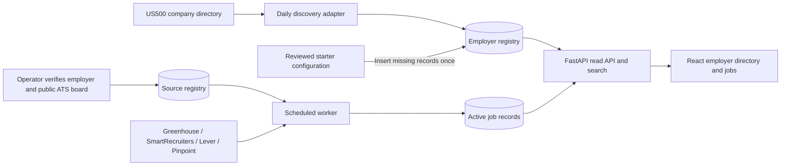

# Employer discovery and live jobs

Company discovery and vacancy ingestion are separate pipelines. A company can be known to the application before it has a verified careers link or a connected job feed. AItlas never turns a directory mention into a job vacancy, an India-office claim or an employee rating.



## What is stored where

| Data | Runtime authority | How it changes |
|---|---|---|
| Company names, reviewed aliases, careers URL, categories and recognition metadata | `employers` table | Daily discovery inserts new companies; reviewed operator changes persist |
| Directory identity and latest valid observation | `employer_catalogs` table | Successful source refresh or an explicit reviewed observation import |
| Company-to-directory references, original listed name, last seen and missing-snapshot count | `employers.references` JSON column | Valid complete discovery snapshots |
| Endpoint URL, adapter, employer mapping, enablement, poll interval, next attempt, failures and last success | `sources` table | Operator CLI and scheduler |
| Vacancies, original application links, city, role, AI heuristic, checked timestamps and availability | `items` table | Successful official ATS snapshots |
| Starter employers, careers links, categories and reviewed aliases | `backend/config/intelligence.json`, `employer_aliases.json`, `sources.json` | Bootstrap inserts missing records; it does not overwrite existing DB edits |

Docker uses PostgreSQL; local Python-only mode defaults to SQLite. Alembic migration `0003` adds the employer tables without replacing existing jobs. The API reads employer records from the database, not a React list or the JSON seed files. Existing reviewed company case studies in `companies`/`evidence` remain a separate feature.

## What is automatic

The US500 source runs daily through the same persisted scheduler as the other connectors. Every successful complete refresh can add newly listed companies without changing frontend code or editing a list of names. Known names and reviewed aliases are matched exactly; fuzzy matches do not merge unrelated companies. All company rows observed on the supplied page are imported. The inspected page contains 471 public-company rows, despite its Fortune 500 heading. It explicitly disclaims Fortune affiliation; the importer stores names and provenance, not ranks, revenue, headcount or official Fortune badges.

Connected employer boards refresh vacancies every one to two hours. New postings appear automatically and remain searchable under city, role, employer and AI filters. The four priority cities remain Hyderabad, Bengaluru/Bangalore, Pune and Chennai. Unknown companies immediately appear as discovery records, with outbound job-board searches carrying those filters.

The older GCC guides and employee-review directories remain reviewed discovery references. They are initial seeds, not scheduled crawlers. Adding another directory format requires a reviewed adapter. New company discovery does **not** automatically enable a guessed ATS board: company identity, board ownership, public access and reuse permissions need verification. Once a source is connected through the operator CLI, its jobs refresh automatically.

## Coverage states

- **Connected job feed:** numeric counts come from indexed active vacancies, under the selected city/role/AI filters.
- **Official careers link:** the employer's careers destination is known, but its vacancies are not imported.
- **Discovery only:** company name and directory provenance are known; official careers/feed and India-office coverage remain unverified. No fabricated count or application URL is displayed.

Selecting US500 in the directory filter includes its entire current catalog. Search accepts reviewed aliases. The UI renders 24 employer cards at a time while filtering the loaded registry; global search also includes employer records. At much larger scale, move directory filtering/pagination to SQL and add PostgreSQL full-text indexing. This version reads the small registry in one batch, avoids per-company SQL queries and keeps network collection out of HTTP request handlers.

## Failure handling and freshness

The parser requires a complete company table, consecutive row ordinals, unique names and bounded size. Unexpected format changes and large catalog shrinkage preserve the previous valid snapshot. HTTP 429 is not immediately retried; `Retry-After` is persisted in the next scheduled attempt (bounded to one day). Other failures use exponential backoff. Last successful records remain visible with source-health information.

A company disappearing from two successful catalog snapshots loses that current directory citation. Discovered-only records can become inactive but are retained in the database; curated employers remain. Directory changes never expire jobs. Job availability is controlled only by its official board snapshot and the existing two-successful-misses policy. PostgreSQL advisory locking prevents concurrent scheduler cycles on the current single-host deployment.

A reviewed observation can initialize the local catalog when a public source rate-limits direct access. Its provenance timestamp is recorded, the UI identifies an observation import, and network health is left unchanged. No 471-name source snapshot is baked into application code or committed as a permanent fallback. A new installation retrieves its catalog through the worker when the source is available.

## Operator examples

```bash
cd backend
uv run python -m app.bootstrap
uv run python -m app.sources list
uv run python -m app.sources set-interval us500-employers 1440
uv run python -m app.employers set-careers EMPLOYER_ID https://official-employer.example/careers
```

Connecting a verified board uses `app.sources add-source` as documented in [JOBS_DATA.md](JOBS_DATA.md). An observed import uses `app.employers import-observed FILE --source us500-employers`; the file contains the exact source URL, a past ISO timestamp with timezone, and `companies: [{"name": "Company"}]`. It must match an existing catalog source and cannot replace a newer valid observation. There is no public source-management or employer-edit HTTP API.

This is the implemented single-host architecture. Multi-host availability still requires replicated application instances, database failover, durable backups, monitoring and the deployment controls described in [ARCHITECTURE.md](ARCHITECTURE.md).
